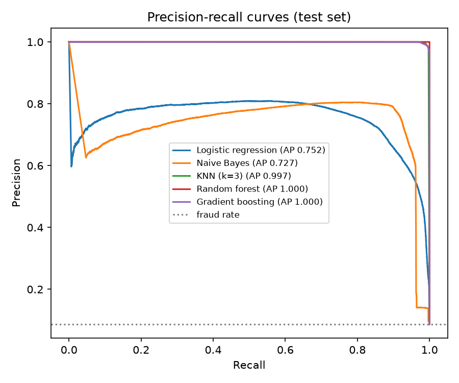
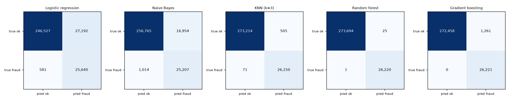
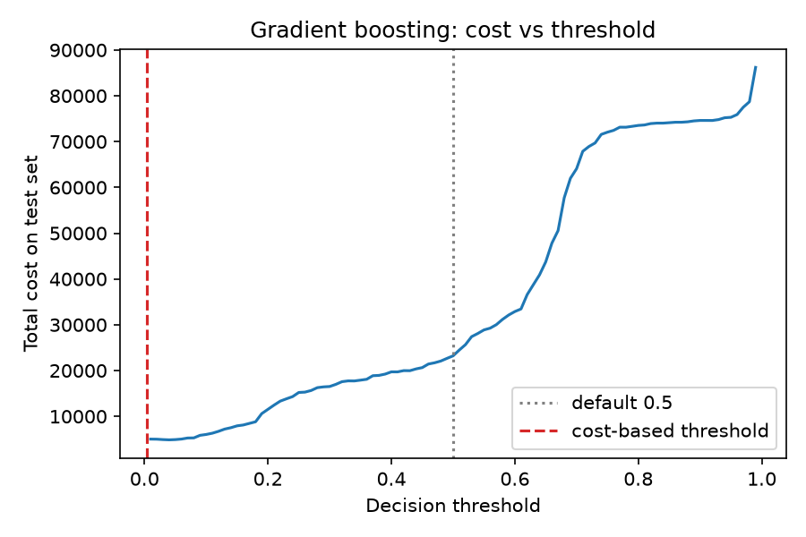
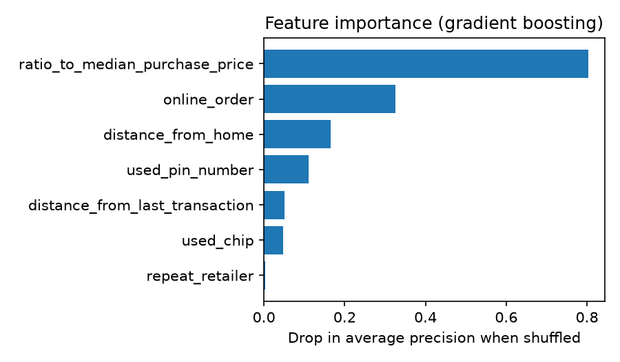

# Credit Card Fraud Detection

Fraud-detection pipeline on 1,000,000 card transactions (7 features, 8.7% fraud): five models compared with leak-free evaluation, precision-recall analysis, a cost-based decision threshold, feature importance and a drift check.

Run it:

```bash
pip install -r requirements.txt
python fraud_pipeline.py            # uses card_transdata.csv in this folder
```

It writes the figures and `metrics.json` to `results/` and the gradient-boosting model to `models/fraud_model.joblib` (with its feature list and chosen threshold). `CREDIT_CARD__FRAUD.ipynb` is the original Colab exploration; the script replaces it.

## Method

- 200 rows with a missing `ratio_to_median_purchase_price` are dropped; `online_order` is encoded 0/1.
- 70/30 stratified train/test split. A further 20% of the training rows is held out to pick thresholds, so the test set is used only to report.
- Scaling happens inside each model's pipeline, so it only sees training rows. (The original notebook scaled before splitting.)
- No test row duplicates a training row (checked by hashing).

## Results (test set, 299,940 transactions)

Precision and recall are for the fraud class. "Cost threshold" is chosen on the validation split to minimise total cost, assuming a missed fraud costs 100 and a false alarm costs 5. Those costs are illustrative; change `COST_MISSED_FRAUD` and `COST_FALSE_ALARM` in `fraud_pipeline.py`.

| Model | Avg. precision | ROC AUC | Precision / recall at 0.5 | Precision / recall at cost threshold | Cost at 0.5 -> cost threshold |
|---|---|---|---|---|---|
| Logistic regression (balanced) | 0.752 | 0.979 | 0.575 / 0.950 | 0.485 / 0.978 | 223,430 -> 194,045 |
| Naive Bayes | 0.727 | 0.964 | 0.793 / 0.609 | 0.598 / 0.961 | 1,045,990 -> 186,170 |
| KNN (k=3) | 0.997 | 0.999 | 0.995 / 0.990 | 0.981 / 0.997 | 27,410 -> 9,625 |
| Random forest | 1.000 | 1.000 | 1.000 / 1.000 | 0.999 / 1.000 | 800 -> 225 |
| Gradient boosting | 1.000 | 1.000 | 0.989 / 0.992 | 0.955 / 1.000 | 23,215 -> 6,200 |

3-fold cross-validated average precision: logistic regression 0.760 (std 0.002), gradient boosting 0.9997 (std 0.0001).




**Read these numbers with care.** Tree-based models and KNN score near-perfectly, even though no test row appears in training. That is what you would expect if the labels were generated from rules over these features, as in a synthetic dataset, and I can't confirm where the data came from. Treat the project as a method demonstration, not evidence of real-world fraud performance. The linear models are much weaker, which suggests the fraud rule is non-linear.

## Threshold and cost

Accuracy is a poor guide at 8.7% fraud, so models are compared by precision, recall and average precision, and the threshold is chosen by cost. Moving off 0.5 cut total cost for every model, most for Naive Bayes (about 82% lower) because its default threshold missed 39% of fraud.



## Feature importance (gradient boosting, drop in average precision when shuffled)

`ratio_to_median_purchase_price` 0.80, `online_order` 0.33, `distance_from_home` 0.16, `used_pin_number` 0.11, `distance_from_last_transaction` 0.05, `used_chip` 0.05, `repeat_retailer` 0.003.



## Drift check

Population stability index (PSI) per feature against the training data (under 0.1 stable, 0.1 to 0.25 watch, over 0.25 drifted). Train vs test is about 0 for every feature. Two simulated shifts, with labels unchanged:

| Shift | PSI (distance from home / ratio to median) | Average precision |
|---|---|---|
| none | 0.000 / 0.000 | 0.9997 |
| mild (distance x1.5, ratio x1.3) | 0.080 / 0.055 (both "stable") | 0.702 |
| strong (distance x3, ratio x2) | 0.576 / 0.378 (both "drifted") | 0.435 |

A mild shift can pass a PSI check and still hurt the model badly, so PSI on inputs should be paired with monitoring of model performance when labels arrive.

## Files

- `fraud_pipeline.py` — the full pipeline
- `results/` — figures and `metrics.json`
- `models/fraud_model.joblib` — gradient-boosting model, feature list and threshold
- `card_transdata.csv` — the data (55 MB)
